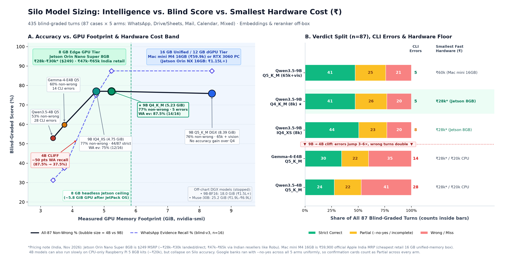

# Model sizing for Silo: where the intelligence cliff sits vs. hardware cost (₹)

This note summarizes the 26 November 2026 five-arm quantization and smaller-model shootout ([benchmarks/runs/2026-11-26-jetson-quant-shootout/README.md](../benchmarks/runs/2026-11-26-jetson-quant-shootout/README.md)), maps each model's measured GPU footprint to the smallest practical hardware you can buy in India, and records the resulting live swap behind `silo.idli.cc`.

## How big the evidence is

- **435 blind-graded turns** (`87` cases × `5` arms) on frozen code (`49cd8e6`), holding retrieval sidecars (`Qwen3-Embedding-0.6B-Q8_0` and `bge-reranker-v2-m3-Q8_0`) constant across every arm.
- **Four suites spanning Silo's real workload:**
  1. `wa_blind_v3` (**20** unseen WhatsApp cases — 10 single, 6 multi-message, 4 controls — `0` ID or body overlap with any prior dev/held-out bank).
  2. `mixed_google_wa` (**16** cross-routing cases on one combined Google + 24-chat WhatsApp DuckDB: 4 Drive/Sheets, 3 Mail, 1 Calendar, 4 WA, 4 boundary controls).
  3. `tasks_owner_dev` (**19** Google turns across Drive PDFs/cards, Sheets, Gmail leads, Calendar) run with `--no-yes`.
  4. `tasks_heldout` (**32** Google turns across Mail, Calendar, Drive, Sheets, write refusals, connector boundaries) run with `--no-yes`.
- **Jetson-realistic serving flags for all four candidate arms:** `-ngl 999 -c 8192 -np 1 -fa on --cache-type-k q8_0 --cache-type-v q8_0`, with **no `mmproj`** vision tower. Only the baseline arm (`qwen35_9b_q5`) kept the DGX `65k` context + `mmproj-F16.gguf` footprint.
- **Strictly blind grading:** three independent `codex exec` grader runs verified answers against read-only SQL over the underlying DuckDB snapshots.

## Where the dropoffs are

The chart above reveals **two sharp structural facts** — a flat plateau inside 9B, and a steep cliff below it:

| Model arm | Params | GGUF disk | Measured GPU RAM | All-87 C / P / W | Non-wrong | WA evidence recall | CLI errors | Smallest practical hardware (India, Nov 2026) |
|---|---:|---:|---:|---:|---:|---:|---:|---|
| **`Qwen3.5-9B-Q5_K_M`** (DGX baseline, `65k` + vision) | 9B | 6.13 GB | 8.39 GiB | 41 / 25 / 21 | 76% (66/87) | 87.5% (14/16) | 5 | **Mac mini M4 16GB (₹59,900)** or RTX 3060 12GB PC (~₹60k); Jetson Orin NX 16GB (₹1.15L+) |
| **`Qwen3.5-9B-Q4_K_M`** (`8k`, no vision) ★ | 9B | 5.29 GB | **5.23 GiB** | **41 / 26 / 20** | **77% (67/87)** | **87.5% (14/16)** | **5** | **Jetson Orin Nano Super 8GB** (~₹28k–₹30k landed at $249 MSRP; ₹47k–₹65k India reseller retail) |
| **`Qwen3.5-9B-IQ4_XS`** (`8k`, no vision) | 9B | 4.81 GB | **4.75 GiB** | **44 / 23 / 20** | **77% (67/87)** | 75.0% (12/16) | 8 | **Jetson Orin Nano Super 8GB** (~₹28k–₹30k landed; ~500 MiB extra OS/DuckDB headroom) |
| **`Gemma-4-E4B-it-Q5_K_M`** (`8k`, no vision) | ~4.5B | 5.11 GB | 3.75 GiB | 30 / 22 / 35 | 60% (52/87) | 37.5% (6/16) | 14 | Jetson Orin Nano Super 8GB (₹28k–₹30k*) or slow CPU-only RPi 5 8GB (~₹20k) — **unusable accuracy** |
| **`Qwen3.5-4B-Q5_K_M`** (`8k`, no vision) | 4B | 2.93 GB | 3.39 GiB | 24 / 22 / 41 | 53% (46/87) | 31.3% (5/16) | 28 | Jetson Orin Nano Super 8GB (₹28k–₹30k*) or slow CPU-only RPi 5 8GB (~₹20k) — **unusable accuracy** |

*(Off-chart legacy DGX models that were sitting idle in GPU memory: `Qwen3.5-9B-BF16` at `18.0 GiB` and `Muse-Glimmer-30B-Q4` at `25.2 GiB` — requiring ₹1.5L–₹6.9L class hardware such as Mac mini M4 Pro 24–48GB, an RTX 3090/4090 rig, or an NVIDIA DGX Spark 128GB.)*

### 1. Zero accuracy penalty from `Q5_K_M` (`8.39 GiB`) → `Q4_K_M` (`5.23 GiB`) / `IQ4_XS` (`4.75 GiB`)

- Dropping quantization from `Q5_K_M` to `Q4_K_M`, trimming context from `65k` to `8k`, and removing the unused `mmproj` vision tower cut GPU memory by **3.2–3.7 GiB** and improved DGX median latency by **20–30%** (`3.7–4.5 s` → `2.3–4.2 s`).
- Across all 87 turns, both 4-bit 9B quants matched or edged `Q5_K_M`: `67/87 (77%)` non-wrong vs `66/87 (76%)`.
- **No `-c 8192` overflows:** the largest prompt across all 435 turns — including the combined Google + 24-chat WhatsApp catalog — was `16,841` characters (~4.5k tokens), with `0` `mapper_failed` turns.
- **Why `Q4_K_M` is the default pick over `IQ4_XS`:** `Q4_K_M` tied `Q5_K_M` on WhatsApp evidence recall (`14/16`), kept `0` cross-store routing leaks on Mixed (`4/4` on Mixed WA), and held CLI errors at `5`. `IQ4_XS` actually led on strict Google correct (`44/87` overall), making it the immediate ~500 MiB headroom fallback if a physical 8 GB Jetson board approaches swap under JetPack + DuckDB + `silo-wa-sync`.

### 2. The 4B cliff is steep and saves zero hardware cost for fast inference

- Both 4B models failed Silo's CLI grammar and retrieval binding:
  - **`Qwen3.5-4B-Q5_K_M`** dropped from `77%` → `53%` non-wrong, crashed from `87.5%` → `31.3%` on WhatsApp evidence recall (`0/4` on Mixed WA), and multiplied CLI errors by **5.6×** (`28` vs `5`).
  - **`Gemma-4-E4B-it-Q5_K_M`** passed WA boundary controls (`4/4`) and did better on Mixed (`9/1/6`), but collapsed to `37.5%` WA evidence recall (`6/16`), failed Drive (`5/10/12`), and triggered **27 `compose()` fallbacks** on Google (`6.8×` worse than 9B).
- **Worse, dropping to 4B does not unlock a cheaper GPU box:** `3.4–3.8 GiB` GPU + ~1.3 GiB OS still exceeds a 4 GB board, so the smallest GPU-accelerated computer that runs them fast is *still* an 8 GB Jetson Orin Nano Super — the exact same box that runs `Qwen3.5-9B-Q4_K_M` / `IQ4_XS`. Running 4B on a CPU-only ₹20k Raspberry Pi 5 8GB loses both speed and accuracy.

### 3. The India street-price reality check (`Jetson 8GB` vs. `Mac mini M4 16GB`)

- At NVIDIA's `$249` official MSRP (direct import / landed **~₹28k–₹30k**), the **Jetson Orin Nano Super 8GB** is half the cost of a **Mac mini M4 16GB (₹59,900 official Apple India MRP)** — and `Qwen3.5-9B-Q4_K_M` / `IQ4_XS` brings Silo squarely inside that ~₹30k envelope.
- However, Indian electronics resellers (e.g., Robu) often list the Jetson Orin Nano Super 8GB at **₹47,000–₹65,000** due to distributor markups and import duties. At ₹60k+, an off-the-shelf **Mac mini M4 16GB (₹59,900)** gives twice the unified RAM (fitting `9B-Q4_K_M` + on-box `idli-embed` + `idli-rerank` with zero offload and faster memory bandwidth at `120 GB/s` vs `102 GB/s`). Sourcing Jetsons near MSRP is therefore what makes the 8 GB edge tier win on cost.

## What failed and what remains uncertain

- **DGX memory ≠ physical Jetson unified memory:** All GPU MiB numbers were measured via `nvidia-smi` on DGX GB10 (CUDA 13.0). A headless 8 GB Jetson shares its 8 GiB between JetPack OS (~1.2–1.5 GiB), DuckDB, `silo-wa-sync` (~10 MiB), and CUDA. One physical Jetson smoke test is still required to decide `Q4_K_M` (`5.23 GiB`) vs `IQ4_XS` (`4.75 GiB`) without swap.
- **Latency scales with memory bandwidth:** On Jetson's `102 GB/s` LPDDR5 (vs ~`273 GB/s` on DGX GB10), expect ~2.5–3× slower decode (~7–12 s median per turn).
- **Embeddings and reranker stayed off-box:** All 5 arms used remote `Qwen3-Embedding-0.6B-Q8_0` (`:8293`) and `bge-reranker-v2-m3-Q8_0` (`:8294`). On an 8 GB Jetson, keep those offloaded (e.g., via `silo.idli.cc/v1/embeddings` and `/v1/rerank`) or run them transiently only during sync.
- **Google `--no-yes` ceiling:** Google banks ran non-interactively (`--no-yes`), so turns stopping at confirmation cards graded `partial` across every arm uniformly. Cross-arm comparisons are exact, but absolute Google `correct` is lower than interactive `--yes` runs.
- **Looped transformers (`Ouro-2.6B`, `SenseNova-Loop-9B`) not yet testable in `llama.cpp`:** Neither architecture is merged into mainline `llama.cpp` yet (`#31571`), so they remain deferred until upstream GGUF support lands.

## Production swap behind `silo.idli.cc`

Following this shootout, the DGX backing `https://silo.idli.cc` was swapped from `Qwen3.5-9B-Q5_K_M` + `mmproj-F16` (`8,591 MiB` / `8.39 GiB`) to **`Qwen3.5-9B-Q4_K_M`** (`5,561 MiB` / `5.43 GiB`, no `mmproj`, `-fa on --cache-type-k q8_0 --cache-type-v q8_0`, 2 concurrent 8k slots via `-c 16384 -np 2`), while idle `idli-muse` (`25,162 MiB`, unused since 20 Nov) and `idli-9b-bf16` (`17,987 MiB`) were stopped — freeing **46,179 MiB (45.1 GiB)** of GPU RAM while keeping `idli-embed` (`6,510 MiB`) and `idli-rerank` (`929 MiB`) online and verified `200 OK` over `https://silo.idli.cc`.
